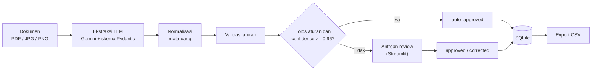

# Document Extraction Pipeline

Pipeline otomatis yang membaca invoice (PDF/gambar), mengubahnya menjadi data terstruktur dengan LLM, memeriksa hasilnya dengan aturan validasi, dan mengarahkan dokumen yang meragukan ke **review manusia** (human-in-the-loop).

> Status: project portofolio, diuji pada **data sintetis**. Hasil pada dokumen nyata belum diukur (lihat bagian [Keterbatasan](#keterbatasan)).

## Masalah yang Diselesaikan

Input data dari dokumen seperti invoice masih banyak dilakukan manual: lambat dan rawan salah ketik. Mengandalkan LLM saja juga berisiko, karena model bisa salah baca tanpa memberi tanda. Project ini fokus pada pertanyaan praktisnya: **kapan hasil AI boleh dipercaya, dan kapan harus diperiksa manusia?**

## Alur Kerja



## Fitur

- **Ekstraksi terstruktur**: output LLM dipaksa mengikuti skema Pydantic (vendor, nomor, tanggal, mata uang, subtotal, pajak, total, item), bukan teks bebas.
- **Validasi aturan deterministik**: field wajib, format tanggal dan mata uang, `subtotal + pajak = total`, jumlah item = subtotal, `qty x harga = jumlah`.
- **Routing berbasis confidence**: dokumen yang melanggar aturan, kurang yakin, atau memiliki field yang diragukan masuk antrean review beserta alasannya.
- **Ketahanan**: retry dengan backoff untuk error sementara (429/5xx), **fallback otomatis ke model cadangan**, dan kegagalan satu dokumen tidak menghentikan batch.
- **Batch yang bisa dilanjutkan**: dokumen yang sudah diproses dilewati, jadi proses yang terputus bisa dilanjutkan.
- **UI review (Streamlit)**: dashboard, antrean review dengan pratinjau dokumen dan formulir koreksi, unggah dokumen baru, dan export CSV.
- **Jejak audit**: output asli AI tidak pernah ditimpa; koreksi manusia disimpan terpisah.
- **Evaluasi terukur**: akurasi per field, efektivitas routing, kalibrasi confidence, dan simulasi threshold.

## Tampilan

<!-- Ganti dengan screenshot Anda sendiri (simpan di folder docs/) -->


## Hasil Evaluasi

Evaluasi memakai **80 invoice sintetis** dengan ground truth yang diketahui: 40 dokumen bersih, dan 40 dokumen yang sengaja dirusak (dimiringkan, diburamkan, diberi noise, bayangan, dan kompresi JPEG) dalam tiga tingkat kesulitan. Model yang dipakai: `gemini-3.5-flash-lite`.

### Akurasi (semua 8 field benar per dokumen)

| Set data | Dokumen | Semua field benar |
|---|---|---|
| Bersih | 40 | 40/40 (100%) |
| Dirusak: ringan | 14 | 14/14 (100%) |
| Dirusak: sedang | 13 | 13/13 (100%) |
| Dirusak: berat | 13 | 11/13 (84.6%) |
| **Dirusak: total** | **40** | **38/40 (95%)** |

Pada set bersih, evaluasi pertama menghasilkan 39/40. Satu kesalahan ditemukan: AI menulis mata uang sebagai `Rp` alih-alih kode ISO `IDR`, dan lolos karena belum ada aturan untuk field itu. Perbaikannya berlapis (prompt, normalisasi, aturan validasi), lalu dievaluasi ulang menjadi 40/40. Perbaikan ini dibuat setelah melihat data yang sama, jadi angka 100% **bukan estimasi independen**.

### Temuan pada dokumen berat

Dua kesalahan, keduanya salah baca **satu digit** (tanggal `...06` terbaca `...05`, nomor invoice `...8066` terbaca `...8006`). Keduanya lolos validasi karena nilainya tetap berformat sah. Aturan berbasis hitungan hanya dapat menangkap angka yang tidak konsisten, **bukan tanggal atau nomor yang salah tapi berformat benar**.

### Kalibrasi confidence (set dirusak)

| Confidence | Dokumen | Semua field benar |
|---|---|---|
| 1.00 | 25 | 25/25 |
| 0.99 / 0.98 | 3 | 3/3 |
| 0.95 | 11 | 9/11 |
| 0.85 | 1 | 1/1 |

Kedua kesalahan berada di confidence 0.95, sedangkan pada set bersih semua dokumen bernilai 1.00. Dari sini threshold dinaikkan dari 0.85 ke 0.96.

### Simulasi threshold (set dirusak, 40 dokumen)

| Threshold | Lolos otomatis | Salah tapi lolos | Dikirim ke review | Review yang tidak perlu |
|---|---|---|---|---|
| 0.85 | 39 | 2 | 1 | 1 |
| **0.96** | **28** | **0** | **12** | **10** |
| 1.00 | 25 | 0 | 15 | 13 |

Menaikkan threshold menukar keamanan dengan beban review: 30% dokumen dirusak dikirim ke manusia, dan sebagian besar sebenarnya benar. Pada set gabungan (80 dokumen) beban review sekitar 15%. Threshold **dipilih dari data yang sama dengan yang dinilai** dan belum dikonfirmasi pada set uji baru.

### Waktu pemrosesan

| Set data | Median | P90 |
|---|---|---|
| Bersih | 2.5 dtk | 11.3 dtk |
| Dirusak | 4.0 dtk | 11.4 dtk |

Nilai ekstrem (hingga 131 dtk) berasal dari retry dan pergantian model saat server API sibuk. Laporan memakai median agar tidak terdistorsi kejadian seperti itu. Tidak ada klaim perbandingan terhadap waktu input manual, karena belum diukur.

Laporan lengkap: [`evaluation_report.md`](evaluation_report.md) dan [`evaluation_report_hard.md`](evaluation_report_hard.md).

## Keterbatasan

- **Data sintetis.** Dokumen dibuat dengan generator dan dirusak secara simulasi, bukan foto invoice asli. Akurasi pada dokumen nyata belum diketahui.
- **Sampel kecil.** Hanya 13 dokumen berat dan 2 kesalahan, jadi pola yang terlihat bisa kebetulan.
- **Threshold disetel pada data yang sama** dengan yang dipakai untuk menilai.
- **Confidence berasal dari model itu sendiri** dan spesifik untuk model yang dipakai. Model cadangan atau versi model berikutnya bisa berperilaku berbeda.
- **Detail item belum dievaluasi.** Evaluasi mencakup 8 field tingkat dokumen; deskripsi, harga satuan, dan jumlah per item belum dibandingkan dengan ground truth.
- **Tidak ada aturan yang menangkap tanggal atau nomor invoice yang salah tapi berformat sah.**

## Rencana Pengembangan

- Set uji baru (seed dan invoice berbeda) untuk mengonfirmasi threshold.
- Uji pada dokumen nyata (misalnya dataset publik CORD atau SROIE).
- Pemeriksaan silang dua model pada field kunci (tanggal, nomor invoice, total).
- Evaluasi detail item.
- Trigger otomatis (folder watcher atau Telegram bot) dan notifikasi untuk antrean review.

## Cara Menjalankan

Prasyarat: Python 3.10+ dan API key Gemini (gratis, dari [Google AI Studio](https://aistudio.google.com)).

```bash
git clone https://github.com/AdidyaDmwan/doc-extraction.git
cd doc-extraction
python -m venv venv

# Windows (PowerShell)
venv\Scripts\Activate.ps1
# Mac/Linux
# source venv/bin/activate

pip install -r requirements.txt
```

Buat file `.env` di root project:

```
GEMINI_API_KEY=isi_key_anda
# Opsional:
# GEMINI_MODEL=nama-model-utama
# GEMINI_FALLBACK_MODELS=model-cadangan-1,model-cadangan-2
```

Nama model bisa berubah dari waktu ke waktu. Lihat model yang tersedia untuk key Anda dengan `python test_models.py`.

```bash
python generate_samples.py                      # 40 invoice dummy + ground truth
python generate_hard_samples.py                 # 40 versi yang dirusak
python run_pipeline.py                          # proses set bersih
python run_pipeline.py --folder data/hard_samples
python evaluate.py                              # laporan set bersih
python evaluate.py --suffix hard                # laporan set dirusak
streamlit run app.py                            # UI review
```

Tes aturan validasi (tanpa API): `python test_validate.py`

## Struktur Project

```
doc-extraction/
├── app.py                    # UI Streamlit (dashboard, review, upload)
├── run_pipeline.py           # pemrosesan batch
├── evaluate.py               # evaluasi terhadap ground truth
├── show_errors.py            # rincian dokumen yang salah / masuk review
├── threshold_sweep.py        # simulasi threshold confidence
├── reroute.py                # hitung ulang status tanpa memanggil API
├── generate_samples.py       # generator invoice dummy
├── generate_hard_samples.py  # generator versi dokumen yang dirusak
├── test_validate.py          # tes aturan validasi dan normalisasi
├── src/
│   ├── schema.py             # skema data (Pydantic)
│   ├── extract.py            # ekstraksi Gemini, retry, fallback model
│   ├── normalize.py          # normalisasi mata uang
│   ├── validate.py           # aturan validasi dan routing
│   ├── pipeline.py           # alur ekstrak, validasi, simpan
│   ├── db.py                 # SQLite
│   └── review.py             # logika UI review
└── data/                     # dokumen contoh dan ground truth
```

## Stack

Python, Gemini API (`google-genai`), Pydantic, SQLite, Streamlit, pandas, Pillow, PyMuPDF, tenacity.
